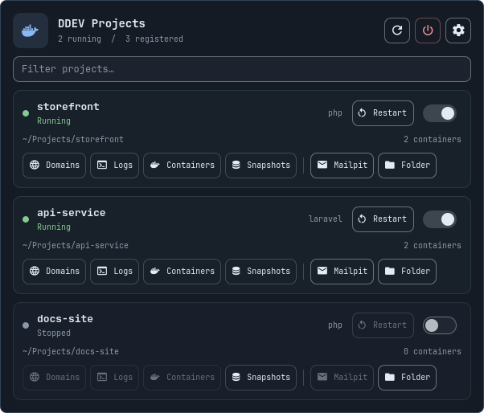
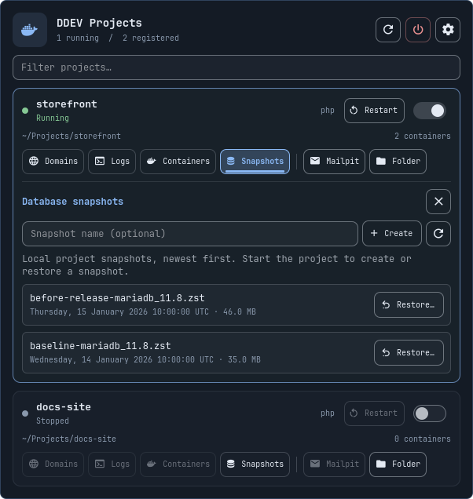
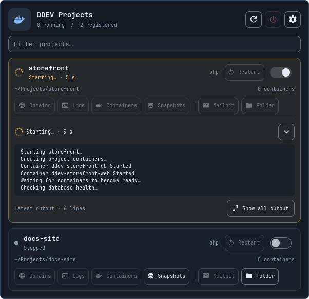
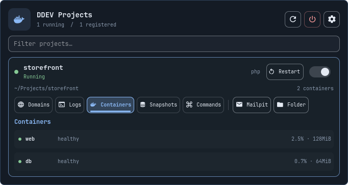
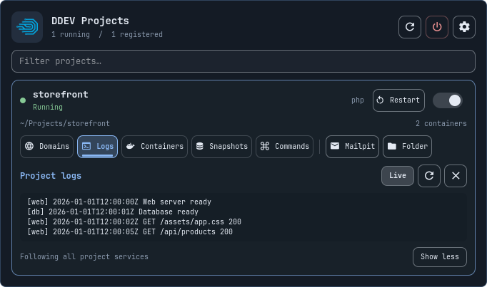
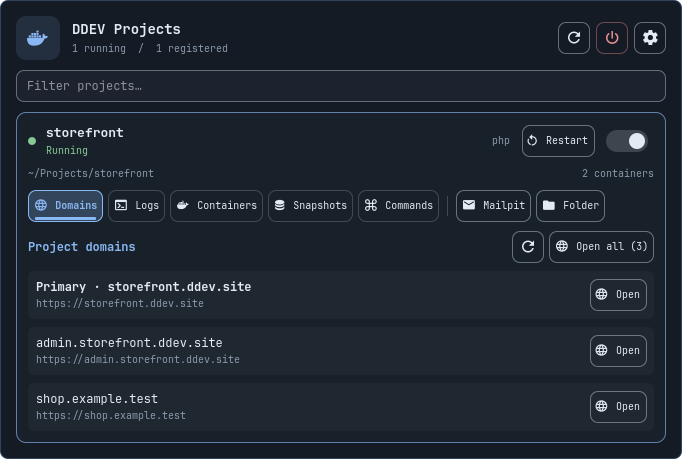

# DDEV Projects for Omarchy

Native Quickshell taskbar plugin. Click the Docker icon and running/registered count beside the system tray.



<details>
<summary>Domains, snapshots, container overview, and logs</summary>











</details>

Previews render the actual plugin interface with fictional projects, paths, snapshots, and console output.

- Lists every project returned by `ddev list -j`, with live status every 15 seconds.
- Sliding start/stop switches, colored project status cards, a distinct, labelled Restart control beside each power switch (enabled only for running projects), and icon shortcuts for browse, Mailpit, and the project folder.
- Detail tabs use an accent fill, border, and underline to show which view is open. Only one detail view opens at a time across all projects; clicking the selected tab closes it. Mailpit and Folder are separated as launch actions.
- Project actions share one left-aligned row: Domains, Logs, Containers, Snapshots, Mailpit, and Folder, all with labels.
- Filter by project name or path.
- Compact container overview with health, CPU and memory; additional metrics on hover.
- View combined live project logs inline, with service labels and no need to switch containers.
- Receive one desktop notification per project transition: started, restarted, stopped, unhealthy, or recovered.
- Show local database snapshots with timestamps and sizes; create automatically named or custom named snapshots.
- Restore a selected snapshot after explicit confirmation that the current database will be replaced.
- Per-project animated spinners and elapsed time during operations. Snapshots and live stdout/stderr appear inside the corresponding project card. Each project keeps its own console output for the shell session. A compact preview shows the latest six lines; **Show all output** expands the card, using only the main panel scrollbar. Shows errors and command output. Docker connectivity errors produce an unknown status rather than a misleading stopped status.

## Install

Requires Omarchy's Quickshell bar, Python 3, DDEV, Docker, `xdg-open`, and `notify-send` (libnotify) for desktop alerts.

Install directly with Omarchy:

```sh
omarchy plugin add https://github.com/ianzano/omarchy-ddev.git --enable
```

To install from a local checkout:

```sh
git clone https://github.com/ianzano/omarchy-ddev.git
cd omarchy-ddev
python3 install.py
```

Installs to `~/.config/omarchy/plugins/ianzano.ddev/` and adds `ianzano.ddev` beside the system tray in `shell.json`. Existing config is backed up to `shell.json.bak.ddev-<timestamp>`. Existing plugin files are backed up under `~/.config/omarchy/plugin-backups/`. Shell config and plugins hot-reload.

`manifest.json`, `Panel.qml`, `backend.py`, and `Monitoring.js` live at the repository root so the repository is directly installable by Omarchy. The repository is named `omarchy-ddev`; the namespaced plugin ID and installed directory name are `ianzano.ddev`.

## Update

For installations made with `omarchy plugin add`:

```sh
omarchy plugin update ianzano.ddev
```

For manual installs, pull the repository and run `python3 install.py` again.

## Usage

**Domains** lists the concrete site URLs reported by `ddev describe -j`, including configured `additional_hostnames` and `additional_fqdns` ([DDEV reference](https://docs.ddev.com/en/stable/users/extend/additional-hostnames/)). Open an individual domain or choose **Open all** to launch one browser tab per domain. The configured primary URL is listed first; other domains prefer HTTPS. HTTP/HTTPS duplicates and incidental loopback endpoints are omitted. Wildcard hosts are not opened literally. Opening a link rechecks it against DDEV's current domain list; it does not accept arbitrary URLs. Refresh or close/reopen the section after changing project domains.


**Containers** expands a compact overview of the services belonging to a DDEV project. Each read-only row shows the service, status/health, CPU and memory. Start, Stop, and Restart remain project-level controls. Hover over the metrics for the memory limit, network I/O, disk I/O, and process count. Statistics update about every three seconds while the overview is open. Paused and stopped containers show unavailable statistics rather than misleading zero values.

**Logs** opens one combined project log. Clicking it again closes the viewer and stops its followers. Reopening preserves the output, expansion, and Live setting; rapid toggles reuse or restart the reader without creating duplicate followers. **Live** follows all discovered DDEV service feeds using `ddev logs --follow --service=<service> --tail=200 --time`, merging their stdout/stderr with `[web]`, `[db]`, and other service prefixes. A plain `ddev logs -f` follows only the web service by default ([DDEV reference](https://docs.ddev.com/en/stable/users/usage/commands/#logs)). Recent output is bounded to 24,000 characters; the non-live snapshot merges the latest 200 lines in timestamp order. Use **Show all logs** to expand within the panel's single scroll area. Following logs does not lock project actions. Turning Live off, closing the viewer, or closing the panel stops its follower processes; reopening or container recreation reconnects the stream.

**Project alerts** in settings toggles desktop notifications. Container events are coalesced after a two-second quiet period into one project-level state, so starting or stopping web and database containers produces one project notification. Plugin-managed lifecycle operations suppress intermediate alerts until the operation finishes and the project is ready. Recovery is announced when all affected services are healthy again. Initial discovery is silent; repeated project states are deduplicated across displays. Externally suspended services do not produce stop/start alerts. Events reconnect automatically when Docker returns; background inventory checks provide a fallback. Idle checks run about every ten seconds; live statistics are collected only while Containers is open. Monitoring covers containers labelled `com.ddev.site-name` for registered projects; shared DDEV infrastructure and services that omit DDEV labels are excluded.

Click Snapshots on a project to expand its database controls directly inside that project’s card. Create accepts an optional name using letters, numbers, dots, underscores, and dashes. Snapshot discovery supports `.gz`, `.zst`, `.mbstream`, and `.xbstream` files, including symlinked `.ddev` directories. The list shows snapshots in the selected project's `.ddev/db_snapshots`; snapshots in other Git worktrees are not included.

The top toolbar’s power icon runs `ddev poweroff` after confirmation, stopping all DDEV projects and shared services. Its live output appears below the toolbar.

Click **Restore…** inside a snapshot card and confirm with **Restore database**. The confirmation identifies the project and snapshot. Switching projects clears the confirmation.

Restoring replaces the current database. Create a fresh snapshot first if you need to preserve it. DDEV handles database compatibility checks; the plugin never uses `--force`. Start the project before creating or restoring a snapshot. Stopped projects keep Folder and snapshot browsing available; Domains, Logs, Containers, Mailpit, Restart, and snapshot mutations are disabled with an explanatory tooltip. Different projects can run operations concurrently, each with its own spinner, elapsed time, and output. Conflicting operations on the same project are blocked until its current command finishes. Global `ddev poweroff` is exclusive and cannot overlap project operations. Keep the shell running while commands finish. Stop runs plain `ddev stop`, without removing database volumes. Commands run as your desktop user. Missing environment variables are filled from the systemd user environment, preserving values already inherited from the desktop. If needed, the SSH agent falls back to the current user’s `ssh-agent.socket` under `XDG_RUNTIME_DIR`. Commands use argument arrays rather than shell strings, and are limited to registered projects. Project actions are consistently labelled on one row; the panel is slightly wider to fit Domains, Logs, Containers, Snapshots, Mailpit, and Folder.

Use the settings gear to adjust the refresh interval with a slider (5–60 seconds); the setting is saved in the bar configuration. Middle-click the widget to refresh. The refresh period can be configured with `refreshIntervalSec` in its bar layout entry. Console text is selectable, with the most recent 24,000 characters retained per project. There is one scroll area for the entire panel; expanded console output has no separate scrollbar. Use **Show less** to return to the latest six lines, or the chevron to collapse the console. The spinner indicates ongoing work, rather than a percentage estimate.

```sh
omarchy-shell ianzano.ddev open
omarchy-shell ianzano.ddev close
omarchy-shell ianzano.ddev refresh
omarchy-shell ianzano.ddev status
omarchy plugin validate .
python3 -m unittest -v test_backend test_install test_containers test_domains
python3 test_ui.py  # Requires the desktop Wayland session; uses simulated projects
```

## Remove

```sh
omarchy plugin remove ianzano.ddev
```

For a manual installation, remove the `ianzano.ddev` entry from the bar layout in `~/.config/omarchy/shell.json`, then delete `~/.config/omarchy/plugins/ianzano.ddev/`. Projects and snapshots are unaffected.

## Validation

Backend tests verify output arrives before a command finishes, merged stderr, Unicode, command exit codes, streaming timeouts, safe stop arguments, command failures, invalid names, unregistered projects, restore path validation, symlinked project config, and unavailable Docker status. The QML component was loaded using the installed Quickshell runtime. No live start/stop, snapshot creation, or database restore is needed for these checks.

Container tests verify Docker label scoping, bounded logs, stats failures, and safe event parsing. Inline UI checks with simulated projects verify read-only container status, log viewing, alert transitions and deduplication, plus card ownership for snapshots and console output, live streaming, six-line previews, full expansion, and separate logs across projects.

## Local data

The repository contains source code and synthetic test fixtures. Project names, paths, environment values, database snapshots, and command output are discovered on the user's machine at runtime. The plugin has no telemetry or upload code; command output and combined project logs remain in memory for the shell session. Lifecycle alerts are delivered through the local desktop notification daemon. Container discovery reads selected state and label fields, not container environment values. Environment variables are passed locally to child processes and are not written to the repository. Local environment files, runtime configs, logs, backups, and snapshot directories are excluded by `.gitignore`.

## License

[MIT](LICENSE) © 2026 ianzano.

## Publishing

The root manifest follows the [Omarchy publishing guide](https://plugins.omarchy.org/publish.html). Validate the repository with `omarchy plugin validate .` before submitting its URL to the marketplace. A valid repository is ready for submission; listing still requires marketplace review.

## Regenerate previews

```sh
python3 tools/render_previews.py
```

Requires the installed Omarchy shell, Quickshell, and a Nerd Font. The renderer runs headlessly with an isolated home and configuration directory. It disables backend discovery and uses synthetic data, without capturing the desktop or running DDEV commands. It writes `preview.png` for the marketplace and additional images under `docs/previews/`.
